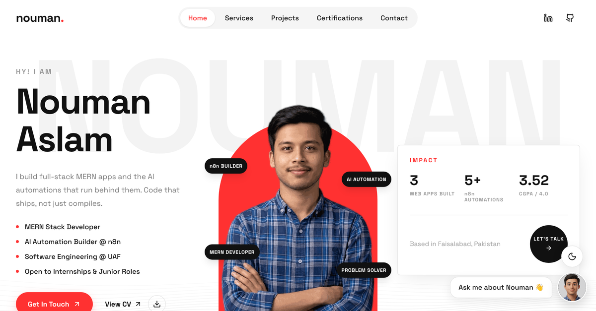

# Nouman Aslam — Portfolio

**MERN Stack Developer & AI Automation Builder.** Code that ships, not just compiles.

**Live:** [nouman-aslam.vercel.app](https://nouman-aslam.vercel.app)



A full-stack portfolio: a React front end, an Express API, an AI chat assistant that answers questions about my work, and a contact form wired to MongoDB and an n8n automation.

## Highlights

- **AI chat assistant.** Ask about my projects, skills or availability. Answers come from Google Gemini, grounded only in my own data, with Groq as a fallback when Gemini is busy. It replies in the visitor's language (English, Roman Urdu, Urdu, Arabic), shows clickable project cards, and supports voice input and read-aloud.
- **Live automation contact form.** Each message is saved to MongoDB and handed to an n8n workflow, where AI classifies it and emails me. A step-by-step tracker shows the visitor what happened, and only shows the steps that really ran.
- **Project case studies.** Every flagship project has its own page with an architecture diagram.

## Tech stack

| Layer | Tools |
|---|---|
| Front end | React 18, Vite, Tailwind CSS, Framer Motion, React Router, lucide-react |
| Back end | Node.js, Express 5, Mongoose, Helmet, express-rate-limit |
| AI | Google Gemini (JSON mode), Groq fallback |
| Data & automation | MongoDB Atlas, n8n |
| Hosting | Vercel (front end and API) |

## Project structure

```
Portfolio/
├── client/                React + Vite app
│   └── src/
│       ├── sections/      Hero, About, Services, Projects, Certifications, Contact…
│       ├── pages/         Home, project case study
│       ├── components/    Chat widget, automation tracker, shared UI
│       └── data/          All site content lives here, not in components
└── server/                Express API
    ├── src/
    │   ├── app.js         The Express app
    │   ├── index.js       Long-running server (local dev)
    │   ├── routes/        /api/chat, /api/contact
    │   └── services/      Gemini, Groq, n8n, chat prompt
    ├── api/index.js       Vercel serverless entry (same app)
    └── knowledge/         What the chat assistant knows about me
```

## Run it locally

You need Node.js 18 or newer.

**1. API**

```bash
cd server
npm install
cp .env.example .env    # then fill in the values below
npm run dev             # http://localhost:5000
```

**2. Front end**

```bash
cd client
npm install
cp .env.example .env    # VITE_API_URL=http://localhost:5000
npm run dev             # http://localhost:5173
```

### Environment variables (`server/.env`)

| Variable | Needed for | Required |
|---|---|---|
| `GEMINI_API_KEY` | Chat assistant ([get a key](https://aistudio.google.com/apikey)) | Yes, for chat |
| `GROQ_API_KEY` | Chat fallback when Gemini is rate-limited ([get a key](https://console.groq.com/keys)) | Recommended |
| `MONGODB_URI` | Saving contact messages | Yes, for contact |
| `N8N_WEBHOOK_URL` | Sending messages to the n8n workflow | Optional |
| `CLIENT_URL` | Allowed front-end origins (comma-separated) | Yes, in production |
| `TRUST_PROXY` | Set to `1` behind Vercel or another proxy | In production |

Without `N8N_WEBHOOK_URL` the contact form still saves every message and tells the visitor so, without promising an email.

## API

| Method | Route | What it does |
|---|---|---|
| `GET` | `/api/health` | Health check |
| `POST` | `/api/chat` | Body `{ messages: [{ role, content }] }`, returns `{ reply, projects }` |
| `POST` | `/api/contact` | Body `{ name, email, company?, message }`, saves the lead and forwards it to n8n |

Both POST routes are rate-limited.

**n8n contract.** The webhook receives the lead as JSON (`name`, `email`, `company`, `message`, `createdAt`, `source`). Its *Respond to Webhook* node should reply with `{ "type": "Recruiter" | "Client" | "Collaboration" | "Other", "notified": true }` so the tracker can show the result.

## Deployment

Two Vercel projects from this one repository:

- **Front end:** root directory `client`, framework Vite, env `VITE_API_URL` = the API's URL.
- **API:** root directory `server`. `server/vercel.json` routes every request to `api/index.js`. Add the environment variables above as secrets.

The automatic retry of leads that n8n missed only runs on a long-running server (`npm start`), not on Vercel.

## Contact

- Email: [mrnoumannomi7@gmail.com](mailto:mrnoumannomi7@gmail.com)
- LinkedIn: [nouman-aslam-a9a3a2333](https://www.linkedin.com/in/nouman-aslam-a9a3a2333)
- GitHub: [CodeWithNouman99](https://github.com/CodeWithNouman99)
