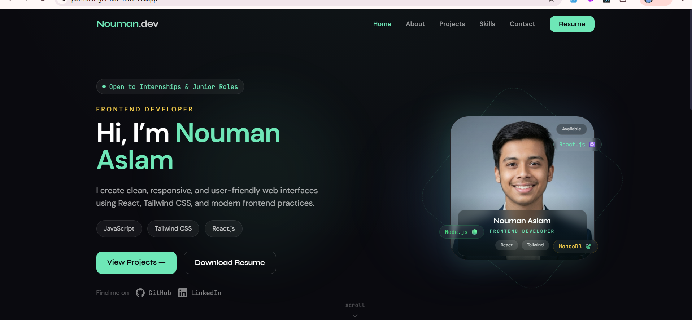
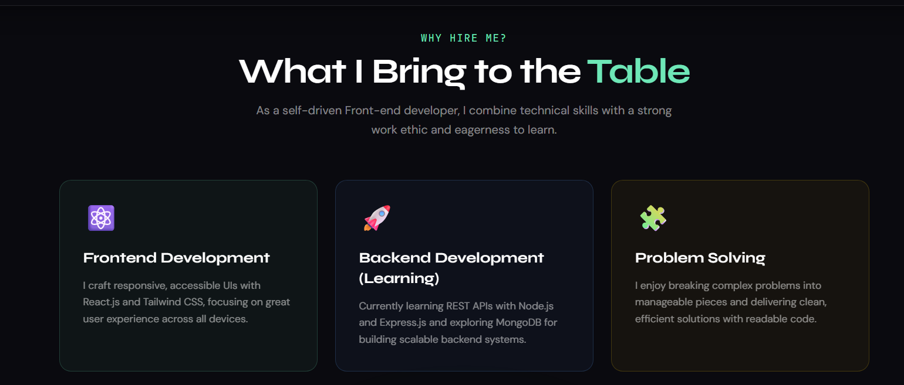
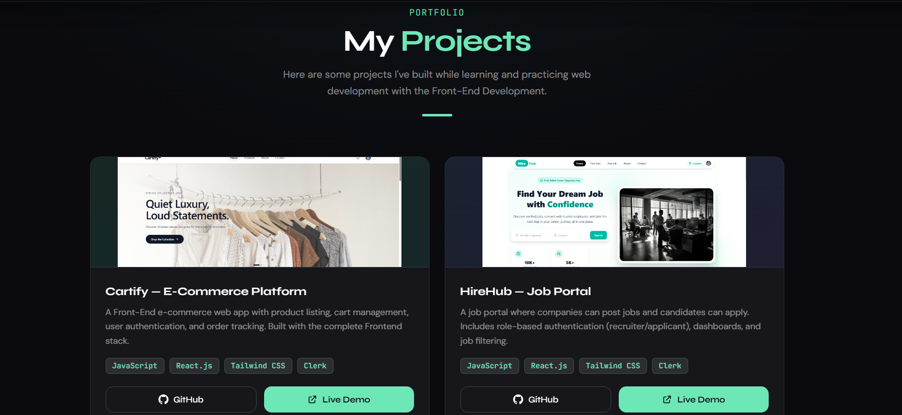

# 🌐 Nouman Aslam - Portfolio

Welcome to my personal portfolio website! This portfolio showcases my skills, projects, certifications, education, and contact information as a Software Engineering student and aspiring MERN Stack Developer.

## 🚀 Live Demo

🔗 **Portfolio:** https://nouman-aslam.vercel.app/

## 📸 Screenshots



<table>
  <tr>
    <td width="50%"></td>
    <td width="50%"></td>
  </tr>
</table>

## 📂 GitHub Repository

🔗 **Repository:** https://github.com/CodeWithNouman99/Portfolio

## 📖 About

I'm **Nouman Aslam**, a Software Engineering student with a passion for building modern, responsive, and user-friendly web applications. This portfolio highlights my journey, technical skills, and projects while serving as a central place where recruiters and developers can learn more about me.

## ✨ Features

* Responsive design for all devices
* Modern and clean UI
* About Me section
* Skills section
* Projects showcase
* Education details
* Certifications
* Contact section
* Smooth navigation

## 🛠️ Tech Stack

* React.js
* JavaScript (ES6+)
* Tailwind CSS
* HTML5
* CSS3
* Vite

## 📁 Project Structure

```text
Portfolio/
├── public/
├── src/
│   ├── assets/
│   ├── components/
│   ├── pages/
│   ├── App.jsx
│   └── main.jsx
├── package.json
├── package-lock.json
└── README.md
```

## ⚙️ Installation

Clone the repository:

```bash
git clone https://github.com/CodeWithNouman99/Portfolio.git
```

Move into the project directory:

```bash
cd Portfolio
```

Install dependencies:

```bash
npm install
```

Start the development server:

```bash
npm run dev
```

Open your browser and visit:

```text
http://localhost:5173
```

## 📌 Sections Included

* Home
* About
* Skills
* Projects
* Education
* Certifications
* Contact

## 📫 Contact

**Nouman Aslam**

* GitHub: https://github.com/CodeWithNouman99
* LinkedIn: https://www.linkedin.com/in/nouman-aslam-a9a3a2333
* Email: mrnoumannomi7@gmail.com

## ⭐ Support

If you found this project helpful, consider giving it a **⭐ Star** on GitHub.

## 📄 License

This project is licensed under the MIT License.
